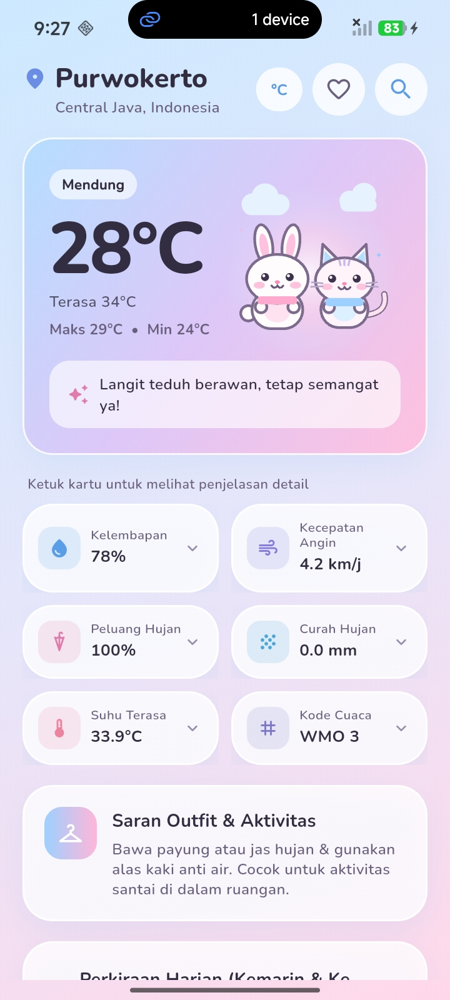
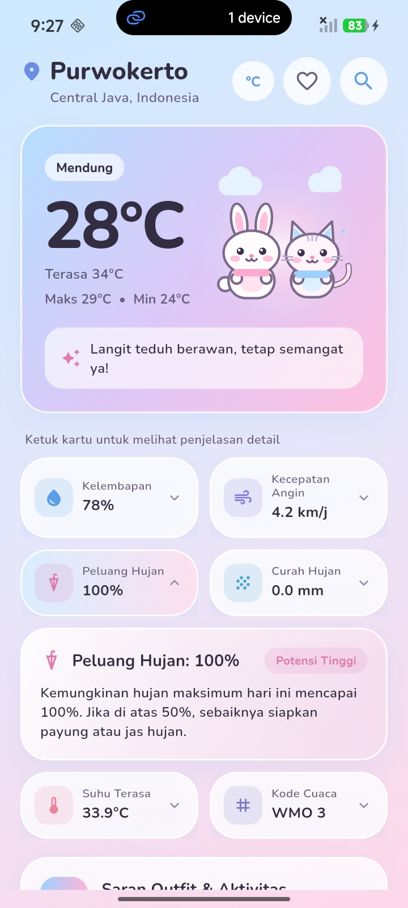
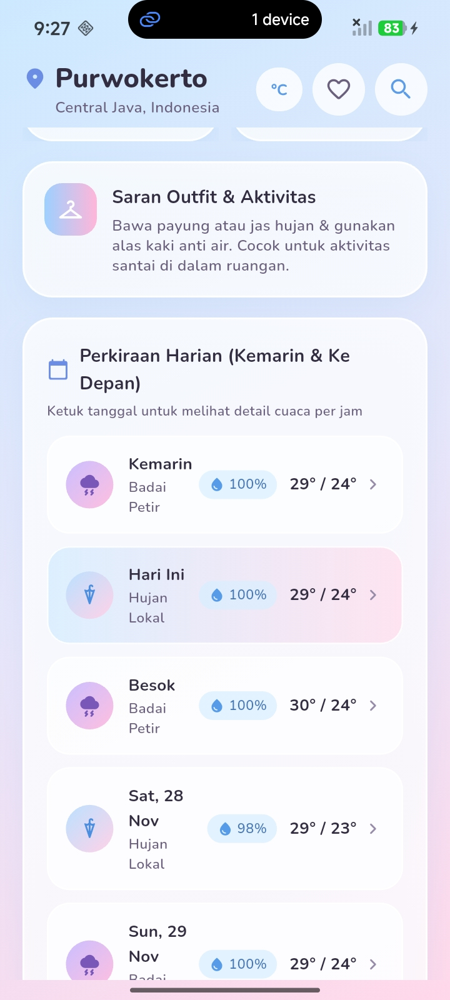
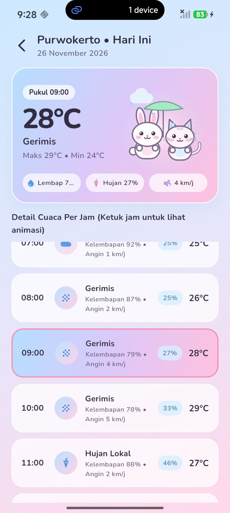
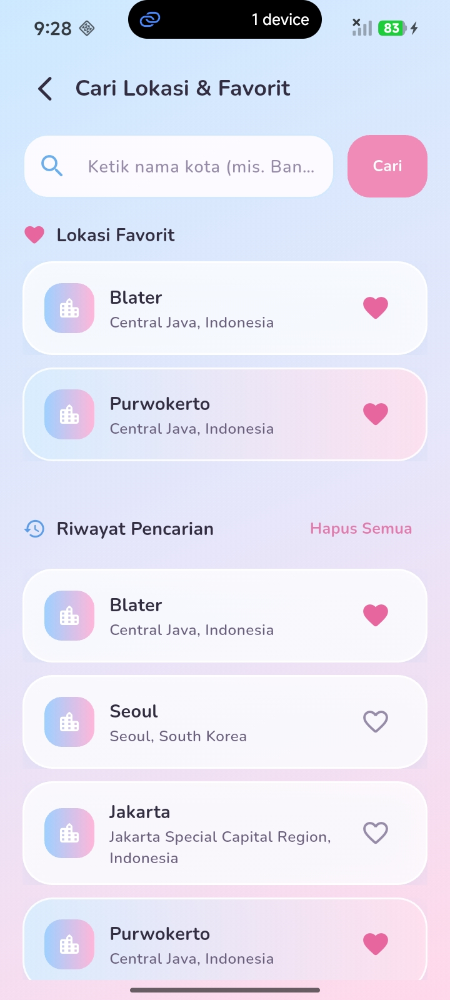
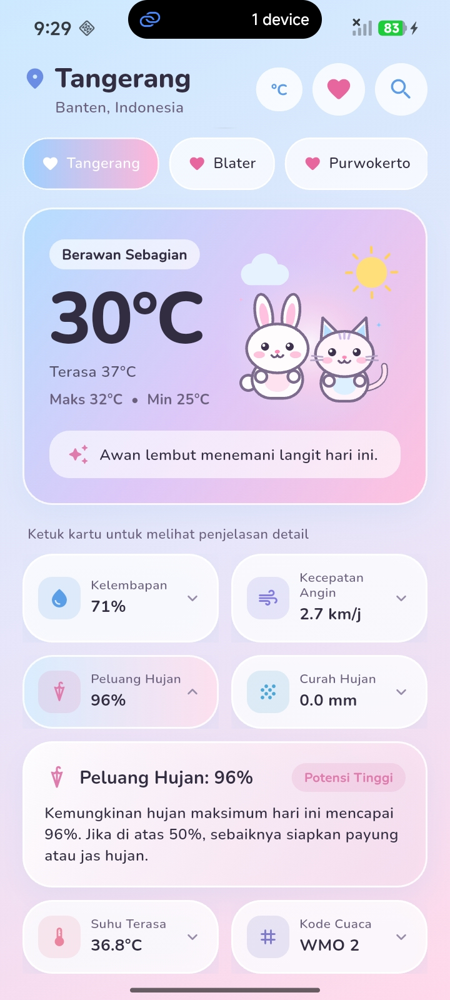

# Pastel Sky Weather

Aplikasi cuaca Flutter bertema **pastel biru dan pink** dengan gradasi lembut serta maskot **Bunny-Cat (Usagi-Neko)** berbasis `CustomPainter` yang menyesuaikan ekspresi dan properti dengan kondisi cuaca terkini dari **Open-Meteo API**.

Dibuat untuk memenuhi **Responsi 2 Praktikum Pemrograman Mobile**.

- **Nama:** Amalia Maharani Andessy
- **NIM:** H1D024032
- **Shift KRS:** E
- **Shift War:** F

---

## Screenshot Aplikasi

1. **Home / Weather Screen (Bagian Atas - Hero Card & Bunny-Cat)**
   

2. **Home / Weather Screen (Detail Metrik Dropdown & Saran Outfit)**
   

3. **Home / Weather Screen (Perkiraan Harian Kemarin & Ke Depan)**
   

4. **Hourly Detail Screen (Kartu Bunny & Cat Pinned + Cuaca Per Jam)**
   

5. **Search / Location Screen (Lokasi Favorit & Riwayat Tersimpan)**
   

6. **Search / Location Screen (Hasil Pencarian Kota Open-Meteo API)**
   

7. **Home / Weather Screen (Setelah Memilih Kota Baru)**
   

---

## Fitur Utama

1. **Home / Weather Screen (`HomeScreen`)**
   - Menampilkan nama kota yang sedang dipilih beserta wilayah/negara.
   - Menampilkan suhu saat ini (`current.temperature_2m`), kondisi cuaca terkini (`current.weather_code`), serta maskot **Bunny-Cat** yang berubah sesuai kondisi cuaca.
   - Menampilkan detail informasi cuaca:
     - Suhu terasa (`current.apparent_temperature`)
     - Kelembapan udara (`current.relative_humidity_2m`)
     - Kecepatan angin (`current.wind_speed_10m`)
     - Peluang hujan maksimum (`daily.precipitation_probability_max`)
     - Curah hujan (`current.precipitation`)
     - Suhu maksimum & minimum harian (`daily.temperature_2m_max`, `daily.temperature_2m_min`)
     - Kode cuaca WMO (`current.weather_code`)
   - Menampilkan perkiraan cuaca harian (kemarin, hari ini, dan hari-hari ke depan) yang dapat diketuk untuk membuka **Hourly Detail Screen**.
   - Mendukung *pull-to-refresh*, tombol simpan favorit, serta akses cepat ke daftar kota favorit.
   - Menangani kondisi *loading*, data kosong, dan *error* dengan tombol coba lagi.

2. **Hourly Detail Screen (`HourlyDetailScreen`)**
   - Menampilkan rincian cuaca per jam (00:00 - 23:00) untuk tanggal yang dipilih (kemarin, hari ini, maupun hari ke depan).
   - Menampilkan suhu per jam, kondisi cuaca, kelembapan, peluang hujan, kecepatan angin, serta ilustrasi **Bunny & Cat** yang berubah mengikuti kondisi jam yang dipilih.

3. **Search / Location Screen (`SearchScreen`)**
   - Input pencarian kota berdasarkan nama kota melalui **Open-Meteo Geocoding API**.
   - Menampilkan daftar hasil pencarian lokasi yang dapat dipilih untuk langsung memperbarui cuaca di `HomeScreen`.
   - Fitur menyimpan dan menghapus lokasi favorit serta riwayat pencarian yang tersimpan secara lokal menggunakan `SharedPreferences` sehingga tetap muncul saat aplikasi dibuka kembali.

---

## Struktur Aplikasi

```text
lib/
├── main.dart                         # Entry point & konfigurasi MultiProvider + Theme
├── models/
│   ├── location_model.dart           # Model data lokasi/kota (Geocoding & Local Storage)
│   └── weather_model.dart            # Model data cuaca terkini & perkiraan harian
├── services/
│   ├── weather_api_service.dart      # HTTP GET request ke Open-Meteo Forecast & Geocoding API
│   └── local_storage_service.dart    # Penyimpanan lokal (SharedPreferences) untuk favorit & riwayat
├── theme/
│   └── app_theme.dart                # Material 3 Theme, Typography (Nunito), & gradasi pastel biru-pink
├── viewmodels/
│   ├── weather_viewmodel.dart        # State management cuaca, lokasi aktif, & favorit
│   └── search_viewmodel.dart         # State management pencarian kota & riwayat pencarian
├── views/
│   ├── home_screen.dart              # Tampilan utama cuaca (Home / Weather Screen)
│   ├── hourly_detail_screen.dart     # Tampilan detail cuaca per jam (kemarin, hari ini, ke depan)
│   └── search_screen.dart            # Tampilan pencarian lokasi & daftar favorit
└── widgets/
    ├── bunny_cat_mascot.dart         # Ilustrasi vektor Bunny-Cat reaktif cuaca (CustomPainter)
    ├── daily_forecast_tile.dart      # Kartu item perkiraan cuaca harian
    ├── pastel_glass_card.dart        # Komponen kartu frosted pastel
    └── weather_icon_widget.dart      # Ikon cuaca pastel berbasis Material Icons
```

---

## Penerapan Arsitektur MVVM

Aplikasi ini menerapkan pola arsitektur **Model-View-ViewModel (MVVM)** dengan bantuan package `provider`:

- **Model (`models/` & `services/`)**:
  - `WeatherModel`, `DailyForecastModel`, dan `LocationModel` merepresentasikan struktur data Dart hasil parsing JSON.
  - `WeatherApiService` menangani komunikasi jaringan ke Open-Meteo, sedangkan `LocalStorageService` mengelola persistensi data favorit, riwayat pencarian, dan kota terakhir yang dipilih di `SharedPreferences`.
- **ViewModel (`viewmodels/`)**:
  - `WeatherViewModel` dan `SearchViewModel` merupakan `ChangeNotifier` yang menyimpan state UI (`isLoading`, `errorMessage`, `weather`, `favorites`, `searchResults`, `searchHistory`), memanggil service, lalu memanggil `notifyListeners()` agar UI terbarui secara reaktif.
- **View (`views/` & `widgets/`)**:
  - `HomeScreen` dan `SearchScreen` hanya bertugas merender UI dan meneruskan aksi pengguna ke ViewModel melalui `Consumer` / `context.read`.

---

## Implementasi API Open-Meteo

Seluruh permintaan jaringan dilakukan menggunakan metode **HTTP GET** melalui package `http` di `WeatherApiService`:

1. **Weather Forecast API**
   - Endpoint: `https://api.open-meteo.com/v1/forecast`
   - Parameter:
     - `latitude` & `longitude`: koordinat lokasi terpilih
     - `current`: `temperature_2m,relative_humidity_2m,apparent_temperature,precipitation,weather_code,wind_speed_10m,is_day`
     - `hourly`: `temperature_2m,relative_humidity_2m,precipitation_probability,weather_code,wind_speed_10m,is_day`
     - `daily`: `weather_code,temperature_2m_max,temperature_2m_min,precipitation_probability_max`
     - `past_days`: `1` (menampilkan data kemarin, hari ini, dan hari ke depan)
     - `timezone`: `auto`

2. **Geocoding API**
   - Endpoint: `https://geocoding-api.open-meteo.com/v1/search`
   - Parameter:
     - `name`: kata kunci nama kota dari input pengguna
     - `count`: `15`
     - `language`: `en`
     - `format`: `json`

Respons JSON diolah menjadi model Dart menggunakan `WeatherModel.fromJson(...)` dan `LocationModel.fromJson(...)`, serta dilengkapi penanganan timeout, status kode non-200, data kosong, dan kegagalan koneksi.

---

## Cara Menjalankan Proyek

```bash
flutter pub get
flutter run
```

Untuk menjalankan pengujian unit dan widget test:

```bash
flutter test
```
